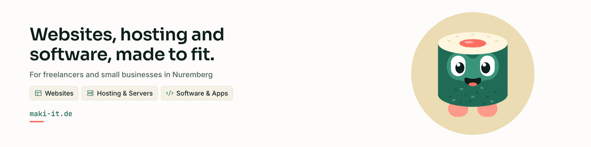

<picture>
  <source media="(prefers-color-scheme: dark)" srcset="https://raw.githubusercontent.com/maki-it/.github/main/profile/banner-dark.png">
  
</picture>

## What we do

&nbsp; **Hosting:** web and mail hosting, applications and managed servers 
&nbsp; **Websites:** concept, design and implementation 
&nbsp; **Software:** development and automation, tailored to your workflows

## Contact

&nbsp; Web: [maki-it.de](https://maki-it.de) 
&nbsp; Email: [kontakt@maki-it.de](mailto:kontakt@maki-it.de) 
&nbsp; Location: Nuremberg, Germany
